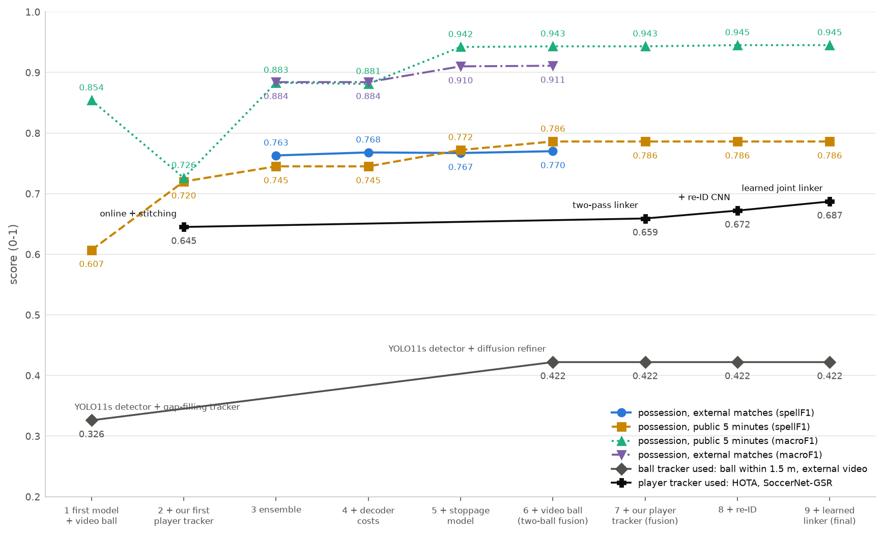

# Ball possession per frame: More than a Hack 2027 submission of team NoTime

One command regenerates the submitted file `NoTime.csv` from the competition data bundle. The method is described in
[`docs/NoTime.pdf`](docs/NoTime.pdf).



Possession scores (external matches and the public 5 minutes) and the external benchmarks of the ball and player
trackers, across the nine versions of the pipeline. Details: section 5 of the technical document.

## Requirements

- Linux, Python 3.12, `git`, and `ffmpeg` with the NVDEC `h264_cuvid` decoder and `ffprobe`.
- An NVIDIA GPU with 16 GB memory and a CUDA ≥ 12.8 driver (tested on an RTX 5080), about 23 GB of free RAM and
  65 GB of disk.
- The competition bundle, unpacked into `data/` or pointed at by `MTAH_DATA_DIR`.
- Access to two of the external training datasets, which `run.py` downloads with the others (about 11 GB in total):
  PFF FC World Cup 2022 (request form at
  [blog.fc.pff.com](https://www.blog.fc.pff.com/blog/enhanced-2022-world-cup-dataset)) and SoccerTrack v2 (a Hugging Face account;
  `.venv/bin/hf auth login`).

## Install

```bash
git clone <this repository> && cd <repository>
python3.12 -m venv .venv         && .venv/bin/pip install -r requirements-final.lock.txt
python3.12 -m venv .venv-vision  && .venv-vision/bin/pip install -r requirements-vision.lock.txt
```

## Run

```bash
MTAH_DATA_DIR=/path/to/bundle .venv/bin/python run.py
```

The command reads `FINAL.json`, downloads and converts the external data, trains the models, runs the video steps,
predicts, decodes and writes the submission file `evaluation/results/NoTime.csv`. It ends by comparing
the file's sha256 with the value in `FINAL.json` and prints whether it matches. A full run takes
4 h 0 min on the tested machine (peak 20.7 GB RAM); an interrupted run resumes
where it stopped.

On another GPU model the video steps can differ in low-order bits. `run.py --allow-drift` then logs the differences
and still writes the file. Other options and per-step details: [`docs/REPRODUCE.md`](docs/REPRODUCE.md).

```bash
.venv/bin/python evaluation/validate_submission.py evaluation/results/NoTime.csv   # the official format check
```

## Layout

| path | content |
|---|---|
| `run.py`, `FINAL.json` | the command and the recipe it reads |
| `src/mtah/` | possession models, features, decoder, rule step, player-source correction and fusion |
| `src/vision/` | ball and person detection, ball-trajectory refiner, player tracker |
| `src/external/` | downloaders and converters of the external datasets |
| `notes/` | model configurations and evaluation splits read by `run.py` |
| `cache/` | shipped weights, trained on external data: detectors, ball refiner, re-ID network, tracklet linker |
| `tools/` | training code of the re-ID network and the linker |
| `evaluation/`, `starter/` | the organisers' metric, validator and starter code |
| `docs/` | technical document, reproduction guide, content hashes of the external inputs |

Licences of third-party components and shipped weights: [`THIRD_PARTY_NOTICES.md`](THIRD_PARTY_NOTICES.md).
