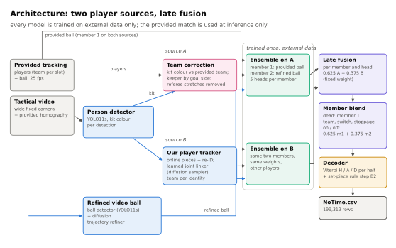
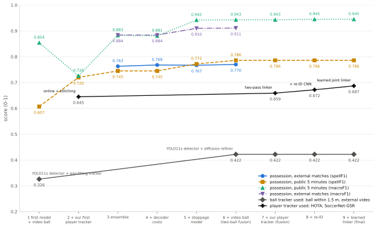

# Frame-level ball possession from automatic tracking and tactical video: a two-source fusion of learned possession models

More than a Hack 2027. Team NoTime: Shaik Mazin Bokhari, Khisravbek Shamsiddinov, Ahmad Kanbari, Haithem Bendjaballah.

## 1. Approach

### 1.1 Task, metric and design consequences

Every tactical frame gets H (Barcelona in possession, ball alive), A (Athletic) or D (ball dead); we write X only
outside the organisers' halves. spellF1 matches predicted and true possessions (maximal H or A runs) one-to-one by
temporal IoU, so a single spurious D frame splits a possession, and a missed one-touch possession of the other team
inside a long possession costs three true possessions. We therefore predict per-frame probabilities and decode
segments with explicit transition costs.

Two properties of the inputs shaped the models:
- **The ball is often missing.** The provided ball is missing on 41% of graded frames, in 150 gaps (median 10.7 s).
- **Ball visibility is confounded with play.** Automatic trackers lose the ball mostly when play is dead (our video ball
  on SoccerTrack v2 is missing on 0.78 of dead frames against 0.50 of live frames), and no external training source has
  a real ball during a stoppage (provider-frozen, masked, or tied to the TV camera). Models trained on such data call
  a visible ball "play": with our video ball on SoccerTrack v2, the recall of D on dead frames with a visible ball is
  0.40, against 0.86 for the same models with the ball removed. Every member therefore contains a players-only
  stoppage model.

### 1.2 The possession models

Each of the two members predicts five heads per frame: p(dead), p(home | alive), and soft boundary heads for a team
switch, for alive -> dead and for dead -> alive. A member has four parts:
- LightGBM heads on 201 permutation-invariant features: ball presence, position and speed, time since and until the
  ball was seen, per-team distances to the ball, restart formations, past and future windows of 0.4-80 s;
- a BiGRU on the same features (3 seeds);
- a tracking transformer: player and ball tokens at 5 fps, a set encoder per frame, a rotary temporal transformer over
  3-minute windows;
- a players-only stoppage BiGRU (2 seeds) trained on copies of the data with the ball removed.

Label-free, match-level consistency gates set how much the neural parts count. All parts are trained on 102 external
matches (section 3). Every training view is degraded: per match a missing-ball fraction drawn from U(0.05, 0.65), half
of the gaps taken from the natural gap lengths of external providers and half log-uniform between 0.2 and 120 s,
placed independently of the labels; 5% player dropout; 0.15 m smooth position noise.

**Member 1** reads the provided ball. **Member 2** is the same recipe trained under the error profile of our
**refined video ball** and reads that ball: a YOLO11s ball detector (trained on SoccerNet-GSR and a Roboflow set)
runs on every tactical frame, and a discrete-diffusion trajectory refiner (trained on external ball tracks) turns its
candidates into one ball per frame. Detection raises ball coverage of graded frames from 59% to about 90%. The refined
ball alone is a worse model input than the provided ball (complete but sometimes wrong), so it enters only through
member 2.

**Member blend**: the dead head comes from member 1; the team, switch and both stoppage-boundary heads are
0.625 · member 1 + 0.375 · member 2 (the plateau centre on external out-of-fold predictions).

### 1.3 Two player sources and late fusion

At inference both members run twice, on two views of the players, with the same ball inputs:
- **Source A, the provided tracking with corrected teams** (`src/mtah/player_fix.py`). The provided team of a tracked
  player is contradicted by its kit colour on about 1% of player-frames: goalkeeper-slot swaps, short identity swaps
  at crossings and referees carried in player slots. Our YOLO11s person detector gives a torso kit-colour histogram
  per detection; kit clusters are fitted on the match without labels. A track's team is corrected where its kit
  contradicts the provided team for a sustained stretch (at least 5 confident calls within ±12 frames, at least 70%
  another kit); a goalkeeper-kit call goes to the team defending the goal he stands in; stretches in referee kit are
  removed. Constants: section 4.
- **Source B, our own tracker** (`src/vision/d4track.py`, section 1.4). Each identity keeps one slot while present
  (the models compute speeds per slot); at most 11 players per team; referees and identities without a team dropped.

For each member and each of the five heads, the probabilities are averaged as 0.625 · A + 0.375 · B, then the member
blend, the decoder and the rule step run unchanged (the rule step reads the provided tracking). The 0.375 is the ratio
of the ball blend, set a priori; it is not fitted. Rather than hand-written rules deciding which player source to trust
at a given moment, the same trained models read both views and their predictions are averaged.



*Figure 1. Architecture.*

### 1.4 Our player tracker (source B)

- **Detections**: the person detector of source A, on every frame (NVDEC decoding, fp16 inference). The frame is upscaled so that players reach the
  size the detector was trained at; the factor is computed from the provided homography (1.5 on this match).
- **Tracklets**: an online tracker in pitch metres (Kalman filter, two-stage ByteTrack-style association with a
  kit-colour cost), cut into pure pieces at detection gaps and kit changes.
- **Re-identification**: a small CNN (about 1.2 M parameters, trained from scratch on SoccerNet-GSR train identities,
  48 px crops, team-mates as hard negatives, batch-hard triplet and identity loss).
- **Learned joint linker**: all pieces of a 30-s window form one canvas; each piece's token points to the earlier
  piece it continues, or is "new" or "junk". A bidirectional transformer (6 layers, width 128, 1.9 M parameters,
  trained from scratch) denoises all tokens jointly with a uniform-token diffusion sampler (24 steps,
  self-conditioning, a per-window seeded generator). One predecessor can be claimed by one successor only, enforced
  inside the sampler. Pair features: motion extrapolation error, time gap, kit-colour distance, re-ID distance and
  team-vote agreement. Where the linker starts a new identity, the classical linker's link is used if free; links
  between identities voted confidently to different teams are vetoed.
- **Team** once per identity: a vote of the provided slots its detections match and of its kit colour; a goalkeeper
  identity goes to the team defending the goal he stands in.
- **Settings**: the link costs, time windows and thresholds of the classical linker were chosen on 19 development
  clips of SoccerNet-GSR, held out from training; physical limits (running speed, penalty-area depth) come from the
  Laws of the Game.
- **Training**: SoccerNet-GSR train only (57 clips of 30 s; tracklets at mixed granularities and three degraded copies
  per clip). The degradations are domain randomisation over ranges set a priori from camera geometry and physics:
  player height 20-60 px (kit histograms re-sampled from that few pixels), detector confidence × U[0.75, 1], Markov
  detection dropout up to 25%, foot-point noise 0.05-0.5 m. The team votes in training come from a simulated provider
  tracking with design values: 0.3 m position noise, a player missing 5% of the time alone and 30% in crowds, gaps of
  1.5 s on average.

| SoccerNet-GSR valid, 58 clips | HOTA | IDF1 | HOTA, degraded | IDF1, degraded |
|---|---|---|---|---|
| online tracker + greedy stitching | 0.645 | 0.784 | 0.503 | 0.601 |
| classical two-pass linker + re-ID | 0.672 | 0.832 | 0.564 | 0.703 |
| **learned linker + classical fallback + team veto (shipped)** | **0.687** | **0.861** | 0.586 \* | 0.739 \* |
| oracle linking of the same pieces | 0.729 | | | |

\* without the team veto (not run on the degraded set; on the clean set it changes HOTA by -0.0001). Learned minus
classical linker: HOTA +0.015 [+0.010, +0.020] clean, +0.023 [+0.017, +0.029] degraded (95% bootstrap over clips).
"Degraded" applies the same a-priori ranges, with a fixed seed, to the valid clips.

On the match (label-free): no team changes inside an identity, about 20 tracks per player over the match, and more
than 11 players of a team on about 3-4% of graded frames.

### 1.5 Decoder

Viterbi over {H, A, D}, per half. Emissions are log frame probabilities [(1 - pD) · pH, (1 - pD) · (1 - pH), pD],
clipped at 1e-4. The transition cost is `max(0, base - 3 · logit(p_boundary(t)))`, with base 3 for H <-> A (switch
head) and 8 for alive <-> D (stoppage heads). A confident boundary head therefore keeps a short possession, while
flicker is suppressed. There is no minimum duration. The values are the plateau centre on external out-of-fold
predictions.

## 2. Assets used, and tried and dropped

| provided asset | in the final pipeline |
|---|---|
| tactical tracking with ball (`BAR-ATH_tactical_atd.txt` / `.xml`) | used: players and ball are the input of both models (player source A, after the team correction); the provided team labels also enter our tracker's team vote (source B); ball and players feed the set-piece rule step |
| tactical video (`BAR-ATH_tactical.mp4`) | used at inference only: ball detection for the refined video ball, person detection for the team correction and for our tracker (player source B) |
| tactical homography (`BAR-ATH_tactical_homography.csv`) | used: maps the video detections (ball and players) to pitch metres |
| Smart Tagging (`BAR-ATH_tactical_smart_tagging.xml`) | used: set-piece tags (throw-in, corner, goal kick, free kick, kick-off after a goal) in the rule step; the play-phase tags were tried as possession evidence and are not used |
| broadcast video | tried (as a stoppage cue and for touches and team calls near the ball), not used |
| broadcast tracking with ball, broadcast homography | tried (broadcast players as an extra player source), not used |

## 3. Training data

All training labels come from other matches: the providers' own labels, or our written possession rule applied to the
providers' event data. No model is trained on the provided match, and nothing is fitted to any label of it. Quantities specific to a match (kit-colour
clusters, grass colour, the referee-colour threshold, a detection-confidence floor, restart windows) are measured at
run time without labels.

| dataset | source | labels: who / how | amount | used for |
|---|---|---|---|---|
| IDSSE / DFL open data | figshare 28196177 (Bassek et al. 2025); event sync from the PathCRF repository | dead = DFL ball status (provider); team = our rule on DFL events | 7 matches, 11.1 h | dead + team heads; ball refiner (provider ball tracks) |
| PFF FC World Cup 2022 | Google Drive after PFF's free-access form | our possession and stoppage rule on PFF events | 64 matches, 109.8 h | team heads; dead heads via ball-removed copies only; ball refiner (provider ball tracks) |
| SkillCorner Open Data | github.com/SkillCorner/opendata @4340d27 | provider phases of play | 20 matches, 32.8 h | team heads |
| Metrica Sports sample data | github.com/metrica-sports/sample-data @e706dd5 | our rule on Metrica's events | 3 matches, 4.8 h | team heads; rule-step timing; ball refiner (provider ball tracks) |
| SoccerTrack v2 | Hugging Face atomscott/soccertrack-v2 v1.2 | provider (BePro) per-frame ball status | 8 of 10 matches, about 12.5 h | dead + team heads; ball refiner (with its video); natural ball gaps of our detector |
| SkillCorner Open Data, 2020 release | github.com/SkillCorner/opendata @1b99d40 | none used: only the lengths of the provider's ball gaps | 9 matches | natural ball-gap pool of the training degradation |
| SoccerNet-GSR 2024 train | Hugging Face SoccerNet/SN-GSR-2024 | SoccerNet annotators' boxes and track identities | 57 clips × 750 frames | ball detector; person detector (every 5th frame, 53 clips); re-ID CNN (38 clips); linker (57 clips) |
| Roboflow Football-Player-Detection v3 | universe.roboflow.com (augmented-startups) | community boxes | 1,232 images | ball and person detectors |
| COCO | through Ultralytics' pretrained `yolo11s.pt` | COCO annotators | Ultralytics' released weights | initialisation of both detectors |

**Possession rule for the external labels.** Possession changes at a controlling action: a kept reception, pass,
carry, shot, recovery, keeper claim or set piece. Tackles and interceptions count only if the same team controls the
ball within 5 s. Clearances, blocks, deflections, saves and failed touches never change possession. D runs from the
stoppage to the restart.

## 4. Possession rules implemented, and constants

The models contain no hand-written possession rule; the rules are the label semantics above, the decoder and one
rule step.
- **Loose balls, challenges, deflections, aerial duels**: no change without subsequent control. No minimum possession
  length; a short possession survives only if the switch head supports it.
- **Dead ball**: the dead-ball sources' conventions (DFL and BePro ball status), including fouls with the ball still on
  the pitch. Broadcast-derived dead labels (PFF) never judge a dead-ball model.
- **Restarts: release, not reception.** The restarting team owns the first alive frame. Every external labeller ends D
  at the release (median offset -0.12 / 0.00 / 0.00 s for IDSSE / PFF / SoccerTrack v2), the first reception follows
  1.5-1.6 s later; training on "D until the first reception" cost 0.03 spellF1 externally.
- **Set-piece rule step** (`src/mtah/tag_layer.py`, no training): each throw-in, corner, goal kick, free kick or
  post-goal kick-off tag with no decoded stoppage in its restart window is checked for ball evidence: the ball more
  than 0.5 m beyond a line for at least 0.4 s, or a still ball at the restart spot. If found, D is inserted from the
  ball going out to the **first reception**. A team run under 0.5 s right after an insertion takes the next label.
- **Halves** are decoded independently.

| rule-step constant | value | source |
|---|---|---|
| pitch; goal area | 105 × 68 m; 5.5 × 18.32 m | provided metadata; Laws of the Game |
| ball out | > 0.5 m beyond the line for ≥ 0.4 s | Laws (wholly over the line) + ball radius + line width + jitter |
| reach; still ball; corner spot | 1.0 m; < 0.5 m/s; 3.0 m | leg reach; placed ball within jitter; corner arc + slack |
| restart window | tag start + [p5, p95] of the offsets to the decoder's own D-run ends, within the tag's own duration | measured at run time, label-free |
| stop durations, flight to reception | per restart type | external Metrica sample data (3 matches) |
| leftover merge | 0.5 s | shorter than any reception-to-next-touch |

| team-correction constant | value | basis |
|---|---|---|
| slot <-> detection gate | 2 m | association geometry |
| goalkeeper track | median distance to the nearest goal line < 16.5 m, present > 60 s | penalty-area depth (Laws) |
| kit clusters / referee centres | main colours of the two outfield kits (match description) + 2 goalkeeper kits / 3; fitted on the match without labels | one group per kit colour; referee + 2 assistants |
| confident call | box ≥ 40 px, unoccluded, colour margin ≥ 0.15 | a priori |
| windowed evidence | ≥ 5 confident calls in ±12 frames, ≥ 70% | a priori |
| fragment majority | ≥ 10 confident calls, > 50% another kit | a priori |

## 5. Progression and evaluation

Figure 2 and the table follow the solution through nine versions. Each version uses one ball tracker and one player
tracker of our own, or the provided tracking only. External evaluation: source-balanced spellF1 (mean of IDSSE, PFF
and SoccerTrack v2) and macroF1 over 59 development matches, 4-fold out-of-fold. The external matches have no video
for our player tracker, so the versions that use it are scored on the public 5 minutes only, the pipeline check the
rules provide (17 possessions: one possession moves spellF1 by 0.03-0.06). The trackers themselves are benchmarked
on external data: the ball tracker by the share of frames with the ball within 1.5 m on held-out SoccerTrack v2
video, the player tracker by HOTA on SoccerNet-GSR valid (58 clips).

| version | our ball tracker (within 1.5 m) | our player tracker (HOTA) | external spellF1 / macroF1 | public 5 min spellF1 / macroF1 |
|---|---|---|---|---|
| 1 first model + video ball | YOLO11s detector + gap-filling tracker (0.326) | - | - | 0.607 / 0.854 |
| 2 + our first player tracker | - | online tracker + stitching (0.645) | - | 0.720 / 0.726 |
| 3 ensemble (LightGBM, BiGRU, tracking transformer; Viterbi decoder) | - | - | 0.763 / 0.884 | 0.745 / 0.883 |
| 4 + decoder costs (switch 3, dead 8, β 3) | - | - | 0.768 / 0.884 | 0.745 / 0.881 |
| 5 + players-only stoppage model | - | - | 0.767 / 0.910 | 0.772 / 0.942 |
| 6 + video ball (two-ball fusion, 0.625 / 0.375) | YOLO11s detector + diffusion refiner (0.422) | - | 0.770 / 0.911 | 0.786 / 0.943 |
| 7 + our player tracker (two-source fusion, 0.625 / 0.375) | same | two-pass linker (0.659) | - | 0.786 / 0.943 |
| 8 + re-ID | same | + re-ID CNN (0.672) | - | 0.786 / 0.945 |
| 9 + learned linker (final) | same | learned joint linker (0.687) | - | 0.786 / 0.945 |

Versions 1 and 2 are earlier model generations; from version 3 on the models are the ones described in section 1.
Per source (version 6): 0.780 / 0.802 / 0.729 (IDSSE / PFF / SoccerTrack v2); on 20 sealed matches scored once,
spellF1 0.765 and macroF1 0.918.



*Figure 2. Possession scores (external matches and the public 5 minutes) and the external benchmark of the ball
tracker and of the player tracker used by each version.*

Technical notes:
- **Decoder costs (version 4).** Transition cost `max(0, base - β · logit(p_boundary))` with base 3 (H <-> A), 8
  (alive <-> D) and β = 3, the plateau centre on external out-of-fold predictions.
- **Stoppage model (version 5).** External spellF1 is unchanged while macroF1 rises 0.884 -> 0.910: on SoccerTrack
  v2 with our video ball, D recall on dead frames with a visible ball is 0.40 for ball-reading models and 0.86 for
  the same models without the ball.
- **Ball tracker (versions 1 and 6).** Within 1.5 m / 3 m on held-out SoccerTrack v2 video: 0.326 / 0.459 with the
  gap-filling tracker, 0.422 / 0.618 with the diffusion refiner.
- **Two-ball fusion (version 6).** Acceptance bar: a paired gain of at least +0.002 with a positive 90% lower bound
  on both external evaluators; measured +0.0031 [+0.0018, +0.0044] and +0.0026 [+0.0003, +0.0052].
- **Player tracker (versions 2, 7, 8, 9).** HOTA / IDF1 on SoccerNet-GSR valid: 0.645 / 0.784, 0.659 / 0.811,
  0.672 / 0.832, 0.687 / 0.861 (section 1.4). The fusion weight is the ratio of the two-ball fusion, set a priori.

Comparison with published methods on the same external matches (report only, the papers' metric definitions):

| method | metric | published / re-implemented | ours |
|---|---|---|---|
| rule-based possession (nearest player, possession zone after Vidal-Codina et al., touch rules, player-speed stoppage rule), re-implemented, tuned out-of-fold | dev spellF1 | 0.299 | 0.770 (version 6) |
| released PathCRF (KDD 2026), true stoppages given | spellF1, 56 dev matches | 0.242 | 0.803 |
| Lang et al. 2022, in-play status | stoppage F1 (IoU ≥ 0.5) | 0.798 published (47 other DFL matches); 0.626 re-implemented on our IDSSE views | 0.949 [0.930, 0.969] (version 6); players-only model 0.910 |

None of these works uses spellF1 or an input like the competition's; the claim is "better than these baselines on
public external data", not "state of the art".

## 6. Limitations

- **Short possessions of the other team** (one or two touches inside a long possession) are mostly missed; they are
  the largest error on the public 5 minutes. Recovering them needs touch detection with team semantics at about 45%
  precision; our best touch detector reached 0.22.
- **Short live spells inside long stoppages** tend to be merged into the stoppage; **whistle stoppages with the ball
  still in play** leave little evidence, and the stoppage heads still tend to read a visible, still ball as play.
- **Goalkeeper holds** and long balls to the keeper: possession is often given to the keeper's team too early.
- **Restart convention**: the models end D at the release, while stoppages inserted by the rule step end at the first
  reception.
- **Our tracker is a weaker model input than the provider's tracking.** It sees only the tactical camera's view, it
  splits players' identities into many pieces on this match, and the models were trained on provider-style errors,
  not on ours. Its team per identity partly uses the provided team labels, so the two sources are not fully
  independent. Same-kit crossings remain its main error (0.04 HOTA below oracle linking on the benchmark).
- **The fusion weight is not validated externally**; it is borrowed from the ball blend.
- **The team correction is not tested externally**: no external source has the provider's error types.
- **Reproducibility depends on bit-identical person detection and tracking.** The possession models use CPU LightGBM
  with fixed threads and CUDA with deterministic algorithms, fixed seeds and TF32 off. The detectors (fp16, cuDNN
  benchmark off), the re-ID CNN and the linker run without PyTorch's deterministic mode, with a fixed batch
  composition and a seeded sampler; k-means is single-threaded. The refined ball, both player sources and the
  tracker output are content-hash checked. This is verified on one GPU model (RTX 5080). On
  another GPU, `run.py --allow-drift` logs differing intermediate files and still writes a CSV, whose final hash check
  may then report a mismatch.
- **Evaluation coverage**: no labelled external source has the competition's exact input; 11 development and 4 sealed
  fixed-camera matches carry every dead-ball decision.
- **With more time**: train on the provider's error types (keeper swaps, identity swaps, referees in player slots)
  instead of correcting the input; a labelled fixed-camera match with dead-ball intervals; a touch classifier on the
  tactical video.

## 7. Reproduction

```bash
python3.12 -m venv .venv && .venv/bin/pip install -r requirements-final.lock.txt
python3.12 -m venv .venv-vision && .venv-vision/bin/pip install -r requirements-vision.lock.txt
MTAH_DATA_DIR=<competition bundle> .venv/bin/python run.py
```

`run.py` downloads the external data, trains both members, runs the video steps, predicts on both player sources,
decodes, validates and compares the CSV's sha256 with `FINAL.json` (exit 1 on a mismatch). Weights whose training is
not bit-reproducible are shipped (all trained on external data only): ball and person detectors, ball refiner, re-ID
CNN and linker; their training scripts are in the repository. A fresh-clone run took 4 h 0 min with a
peak of 20.7 GB RAM (Intel i7-13700K, 46 GB RAM, RTX 5080 16 GB). Options, per-step details and determinism: `docs/REPRODUCE.md`.
